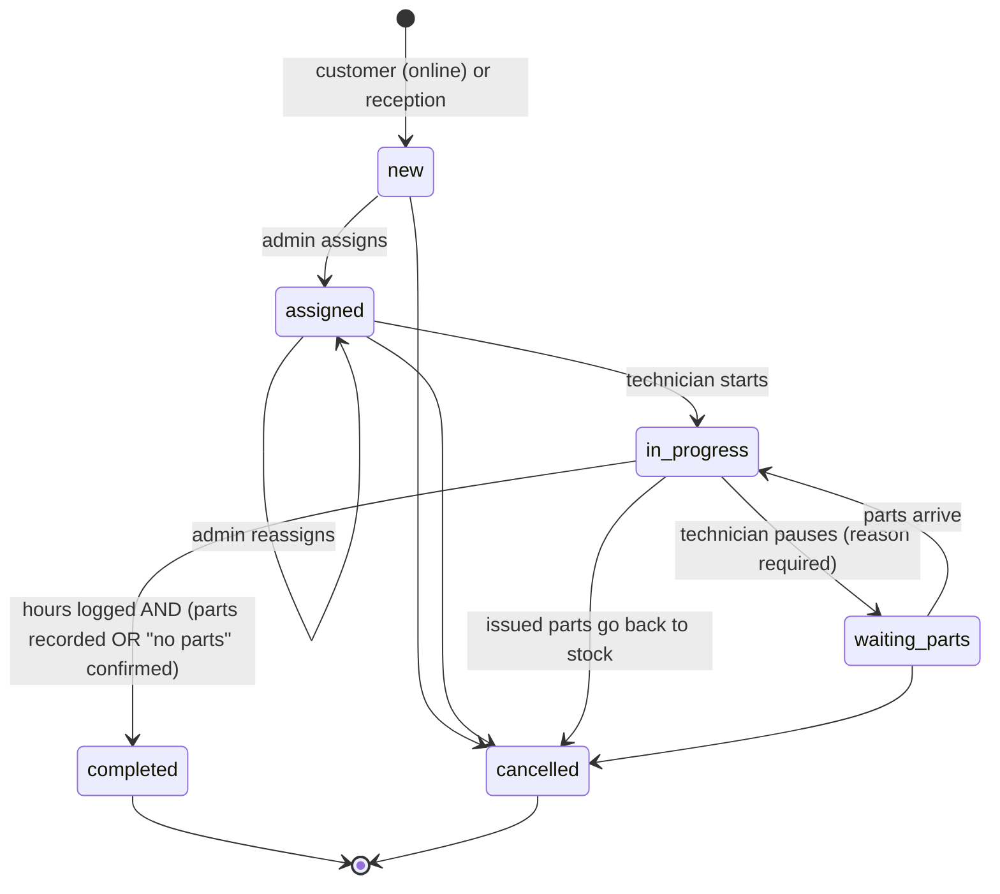
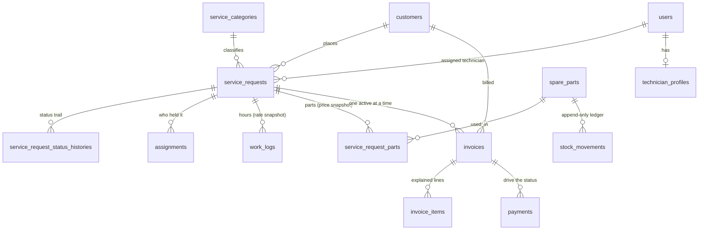
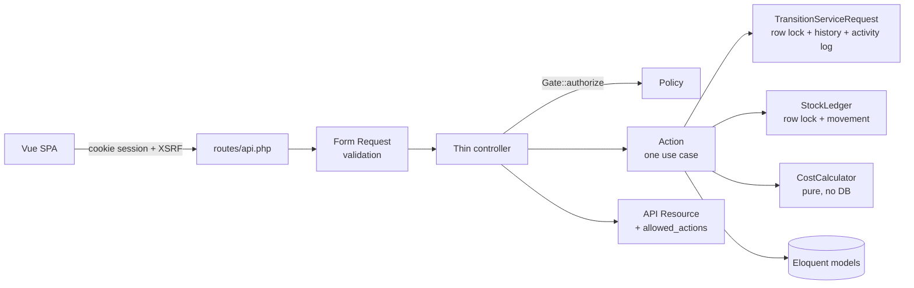

# ServiceFlow

Maintenance-service management for a home-repair company: customers request a technician online
without an account, reception and the operations manager dispatch the work, technicians record
hours and spare parts, and accountants invoice and collect.

**Stack:** Laravel 13 (PHP 8.3) REST API · Vue 3 + Pinia + Vue Router · Bootstrap 5 RTL ·
MySQL 8.4 · Sanctum SPA auth · spatie/laravel-permission · spatie/laravel-activitylog · Chart.js

The interesting part is not the screens but the rules behind them: a strict state machine,
row-locked inventory, money that never touches a float, and permissions enforced by the API,
not by hidden buttons.

---

## Contents

1. [Run it locally](#run-it-locally)
2. [Demo accounts](#demo-accounts)
3. [Roles](#roles)
4. [Request lifecycle](#request-lifecycle)
5. [Data model](#data-model)
6. [Business rules](#business-rules)
7. [Architecture](#architecture)
8. [Architectural decisions](#architectural-decisions)
9. [API reference](#api-reference)
10. [Tests](#tests)
11. [Project layout](#project-layout)

---

## Run it locally

Requirements: PHP 8.3 with `bcmath` and `pdo_mysql`, Composer, Node 20+, and MySQL 8
(Docker is the easiest way to get it).

```bash
# 1. Database (MySQL 8.4 on port 3307, creates serviceflow + serviceflow_test)
docker compose up -d

# 2. API
cd backend
composer install
cp .env.example .env
php artisan key:generate
php artisan migrate --seed        # ~25 s: replays five months of realistic activity
php artisan serve                 # http://127.0.0.1:8000

# 3. SPA (second terminal)
cd frontend
npm install
npm run dev                       # http://localhost:5173
```

Open **http://localhost:5173** for the public site and **http://localhost:5173/login** for the
control panel. Vite proxies `/api` and `/sanctum` to Laravel, so the SPA and the API share one
origin (no CORS, Sanctum cookies just work). In production nginx does the same job.

> **No Docker?** Point `DB_*` in `backend/.env` at any MySQL 8 server, or set
> `DB_CONNECTION=sqlite` for a quick look. SQLite works for everything except the
> concurrency test, because it locks the whole file instead of a row.

### Deploy the live demo (free)

The repository deploys to [Render](https://render.com)'s free plan as one Docker container:
the Vue build is served by Laravel from the same origin as the API.

1. Render → **New → Blueprint** → select this repository (`render.yaml` does the rest).
2. Wait for the first build; the site is at `https://<service-name>.onrender.com`.

The free disk is ephemeral, so `docker/render/start.sh` builds a fresh SQLite database and replays
the demo history on every start: visitors always get clean data. A free instance sleeps after
15 minutes idle; the first visit after that takes about a minute while it wakes and re-seeds.

## Demo accounts

Every password is `password`. The login page lists them and fills the form on click.

| Role | Email | Lands on |
|---|---|---|
| Admin / operations manager | `admin@serviceflow.test` | Dashboard |
| Receptionist | `reception@serviceflow.test` | Service requests |
| Technician | `technician@serviceflow.test` | My tasks |
| Accountant | `accountant@serviceflow.test` | Invoices |

The seeder does not insert finished rows. It replays the story of 180 requests over five months
through the same Actions the API uses, with the clock moved to each moment, sorted chronologically.
Every history row, stock movement and payment is one the real system could have written.

## Roles

| Can… | Admin | Reception | Technician | Accountant |
|---|:-:|:-:|:-:|:-:|
| Create / edit requests and customers | ✅ | ✅ | | |
| Assign or reassign a technician | ✅ | | | |
| Start, pause, log hours, issue parts, complete | | | own jobs only | |
| Cancel a request | ✅ | only while *new* | | |
| Issue invoices, record payments | | | | ✅ |
| Read invoices | ✅ (read-only) | | | ✅ |
| Manage stock | ✅ | | browse only, no cost price | |
| Dashboard | full | | | finance section |
| Users, activity log | ✅ | | | |

Customers never log in. They submit and track requests from the public site
(tracking needs the request code **and** the phone number, so codes can't be enumerated).

## Request lifecycle



Billing is deliberately **not** a request status. "Invoiced" and "paid" are read from the
request's active invoice, whose own status is derived from its payments. Storing the same fact
twice would let the two copies drift apart.

All transitions live in one place, `ServiceRequestStatus::transitions()`, and every change goes
through `TransitionServiceRequest`, which writes a `service_request_status_histories` row and an
activity-log entry in the same transaction.

## Data model



Highlights:

- **Money** columns are `decimal(12,2)`, cast to strings, and computed with `bcmath`.
- **Snapshots:** `service_request_parts.unit_price/unit_cost` and `work_logs.hourly_rate` are copied
  at the moment of use, so changing a price or a raise never rewrites an old invoice.
- **`stock_movements`** is append-only with `balance_after` on every row: the current stock is
  always explainable, and the seeder test checks `SUM(quantity) = stock_quantity` for every part.
- **Indexes follow the queries:** `(assigned_technician_id, status)` for "my tasks",
  `(status, due_at)` for overdue, `(status, issued_at)` for invoice lists.
- **Soft deletes** only where history matters (customers, parts, requests). Users are deactivated,
  never deleted, so their name stays on every record they touched.

## Business rules

| Rule | Where it is enforced |
|---|---|
| A technician sees and acts on their own jobs only (another's request returns **404**, not 403) | `ServiceRequestPolicy`, `assignedTo` scope |
| Illegal transitions (e.g. completed → in progress) are refused, even if called directly | `TransitionServiceRequest` re-checks under a row lock |
| Completion needs logged hours, and parts or an explicit "no parts" | `CompleteServiceRequest` |
| Issuing a part checks stock and deducts it in the same transaction; any failure rolls back both | `AddPartToRequest` → `StockLedger` |
| Stock can never go negative, even under concurrent requests | `StockLedger` (`SELECT … FOR UPDATE`) |
| Cancelling returns issued parts to stock | `CancelServiceRequest` |
| The technician never sends a price; it comes from the stock record | `AddPartRequest` has no price field |
| No invoice before completion; one active invoice per request | `IssueInvoice` |
| Discount is applied **before** tax; tax rate comes from settings, not the request | `CostCalculator`, `Setting::taxRate()` |
| Invoice status is derived from payments; no overpayment; paid invoices are final | `RecordPayment`, `InvoiceStatus::fromAmounts()` |
| An invoice with payments cannot be cancelled; a cancelled one allows a corrected re-issue | `CancelInvoice` |
| Each priority has an SLA (urgent 4 h … low 72 h); overdue = open and past `due_at` | `config/serviceflow.php`, `overdue` scope |
| Public form: rate-limited, honeypot, existing customers are matched by phone but never overwritten | `SubmitOnlineServiceRequest` |
| No self-lockout: admins can't deactivate themselves, the last admin stays, busy technicians can't be deactivated | `UserController::guardRules()` |

## Architecture



A controller method is three steps: authorize with the policy, call one Action, return a Resource.
Every resource for a request includes `allowed_actions`, computed from the same policy, so the UI
shows exactly the buttons the API will accept, and the API re-checks every call anyway.

All responses share one envelope, rendered centrally in `bootstrap/app.php`:

```json
{ "success": true,  "message": "تم تعيين محمود حسن", "data": { } }
{ "success": false, "message": "البيانات المدخلة غير صحيحة", "errors": { "phone": ["…"] } }
```

`ValidationException` → 422, `BusinessRuleException` → 422 with the rule's own Arabic message,
`AuthenticationException` → 401, `AuthorizationException` → 403, not found → 404, throttled → 429.

## Architectural decisions

**Actions instead of fat controllers or one big service.** Each use case (`AssignTechnician`,
`IssueInvoice`, `RecordPayment`…) is a class with one `handle()` method. They are reused by the
HTTP layer, the seeder and the tests, which is why demo data can never break a business rule.

**No repository layer.** Eloquent already is the data-access abstraction; wrapping it would add
indirection without a second implementation to justify it. Reusable queries are local scopes
(`overdue()`, `awaitingInvoice()`, `assignedTo()`).

**Transactions plus row locks, re-checked under the lock.** The policy says "yes" based on what
the caller loaded; by the time the transaction starts, someone may have reassigned or completed
the request. Every write locks the row first and validates against the *locked* state.

**`StockLedger` is the only code allowed to touch `stock_quantity`.** The column is not fillable
and the update endpoint ignores it. Concurrency is proven by a test that starts ten real
processes against five units (see [Tests](#tests)).

**Derived state over stored state.** Billing status is not a request status; invoice status is
recomputed from payments in the same locked transaction. `amount_paid` is a cache, never a source.

**Snapshots for prices and rates.** An invoice must give the same answer next year as today.

**Policies + spatie permissions, not role checks.** Code asks `can('service-requests.assign')`,
never `hasRole('admin')`. Permission names live in the `Permission` enum, so a typo is a
compile-time error rather than a silent "access denied".

**Sanctum SPA cookies, same origin.** The session cookie is HttpOnly and never readable by
JavaScript; CSRF is handled by the `XSRF-TOKEN` cookie. Tokens would make sense for a mobile app.

**Status changes are guarded fields.** `status` is not mass-assignable; a test proves that
`update(['status' => 'completed'])` does nothing.

## API reference

All endpoints are under `/api` and return the envelope above. Staff endpoints need a session
(`GET /sanctum/csrf-cookie`, then `POST /api/auth/login`).

### Public (no login, rate-limited)

| Method | Endpoint | Notes |
|---|---|---|
| GET | `/public/service-categories` | Active categories |
| GET | `/public/stats` | Home-page figures from real data, cached 10 min |
| POST | `/public/service-requests` | Submit a request · 3 per 10 min per IP · honeypot |
| POST | `/public/service-requests/track` | Needs `code` + `phone` · 10 per min per IP |

### Authentication

| Method | Endpoint | Notes |
|---|---|---|
| POST | `/auth/login` | 5 per min per email+IP |
| POST | `/auth/logout` | |
| GET | `/auth/me` | User, role and permissions |

### Service requests

| Method | Endpoint | Allowed |
|---|---|---|
| GET | `/service-requests` | Staff with view-all; technicians get their own only. Filters: `status`, `priority`, `technician_id`, `overdue`, `open`, `awaiting_invoice`, `search`, `sort` |
| POST | `/service-requests` | Admin, reception |
| GET | `/service-requests/{id}` | As above; includes history, hours, parts, `allowed_actions` |
| PUT | `/service-requests/{id}` | Admin, reception (new / assigned only) |
| DELETE | `/service-requests/{id}` | Admin, new requests only (soft delete) |
| POST | `/service-requests/{id}/assign` | Admin |
| POST | `/service-requests/{id}/start` | Assigned technician |
| POST | `/service-requests/{id}/pause` | Assigned technician (`waiting_for` required) |
| POST | `/service-requests/{id}/resume` | Assigned technician |
| POST | `/service-requests/{id}/work-logs` | Assigned technician (quarter-hour steps) |
| POST | `/service-requests/{id}/parts` | Assigned technician (no price field) |
| DELETE | `/service-requests/{id}/parts/{line}` | Assigned technician, returns stock |
| POST | `/service-requests/{id}/complete` | Assigned technician |
| POST | `/service-requests/{id}/cancel` | Admin; reception while new (`reason` required) |
| GET | `/service-requests/{id}/invoice-preview` | Accountant · same calculator, nothing saved |

### Billing

| Method | Endpoint | Allowed |
|---|---|---|
| GET | `/invoices` | Accountant, admin · includes outstanding / awaiting-invoice summary |
| POST | `/invoices` | Accountant · `service_request_id`, `discount`, `due_date` |
| GET | `/invoices/{id}` | Accountant, admin |
| POST | `/invoices/{id}/payments` | Accountant · `amount`, `method`, `reference` |
| POST | `/invoices/{id}/cancel` | Accountant · unpaid invoices only |

### Inventory, people, reports

| Method | Endpoint | Allowed |
|---|---|---|
| GET | `/spare-parts` | Admin, technician, accountant (cost hidden from technicians) |
| POST · PUT | `/spare-parts`, `/spare-parts/{id}` | Admin (stock is not editable here) |
| POST | `/spare-parts/{id}/stock` | Admin · `purchase` or `adjustment` (reason required) |
| GET | `/spare-parts/{id}/movements` | Admin |
| GET | `/technicians` | Admin · with live open / overdue counts |
| GET · POST · PUT · DELETE | `/customers…` | Admin, reception (accountant reads) |
| GET · POST · PUT | `/users…` | Admin |
| GET | `/activity-logs` | Admin |
| GET | `/reports/dashboard?from=&to=` | Admin (all), accountant (finance) · max one year |

## Tests

```bash
cd backend
php artisan test                      # 144 tests on SQLite in memory, ~1 min
                                      # (the concurrency test skips itself without MySQL)

# Real concurrency (MySQL only): 10 processes compete for 5 units of one part
DB_CONNECTION=mysql DB_PORT=3307 DB_DATABASE=serviceflow_test \
DB_USERNAME=serviceflow DB_PASSWORD=secret \
php artisan test --group=concurrency
```

What is covered, by area:

| Area | Examples |
|---|---|
| State machine | allowed and forbidden transitions (unit), stale request after reassignment, history order |
| Permissions | full role matrix, technician 404 on others' jobs, separation of duties for money |
| Inventory | deduct + snapshot, insufficient stock rolls back everything, returns, ledger = balance |
| Billing | `CostCalculator` unit tests (discount before tax, rounding, no float drift), overpayment, re-issue after cancel |
| Public site | no-account submission, Arabic-digit phone normalisation, honeypot, rate limit, tracking leaks nothing internal |
| Reports | KPIs, revenue by month, period filter, zero-filled daily series, sections per role |
| Users | no self-lockout, busy technician can't be deactivated, deactivated account can't log in |

## Project layout

```
backend/
  app/Actions/            one class per use case (ServiceRequests, Inventory, Billing)
  app/Services/           StockLedger, CostCalculator, DashboardReport
  app/Policies/           who may do what, per model
  app/Enums/              statuses with their labels and transitions, permissions, roles
  app/Http/Requests/      validation (Arabic messages in lang/ar)
  app/Http/Resources/     response shapes, including allowed_actions
  database/seeders/       demo data replayed through the Actions
  tests/Unit, tests/Feature
frontend/
  src/pages/public/       landing page, tracking
  src/pages/app/          control panel screens
  src/components/         StatusRail, RequestActions, dialogs, charts
  src/stores/             auth + toasts (Pinia)
  src/lib/http.js         axios with Sanctum cookies, CSRF and the error envelope
docker-compose.yml        MySQL 8.4 for local development
```
